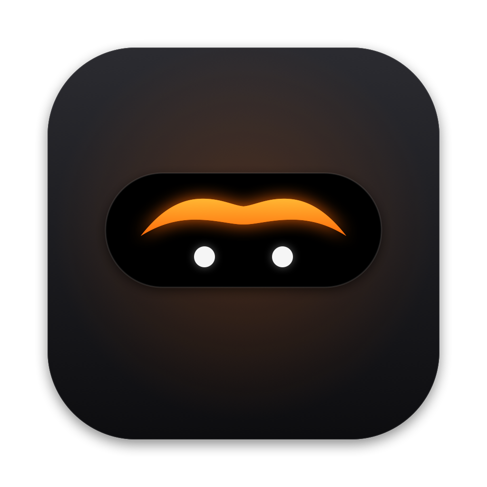

<div align="center">



# Unibrow

**Approve Claude Code from your MacBook notch.**

Every permission prompt, question and “done” from all your Claude Code sessions,
in one list that grows out of the notch. Hover, read, click. Never switch windows.

[](https://github.com/andriitk/cc-unibrow/actions/workflows/ci.yml)


[](LICENSE)

[Install](#install) · [How to use](#how-to-use) · [FAQ](#faq) · [How it works](docs/ARCHITECTURE.md)

</div>

https://github.com/user-attachments/assets/ea03c975-a00d-4885-ab48-418b29f94148

---

## Why

You run Claude Code in five terminals across three projects. One of them has
been waiting two minutes for *“Do you want to proceed?”* in a window you are
not looking at.

Unibrow puts every one of those prompts in the notch, the one place on screen
you always see. A pulsing dot means *Claude needs you*; hover to see what, and
answer right there. The terminal keeps working exactly as before.

## Install

In Claude Code, run:

```
/plugin install cc-unibrow --marketplace andriitk/cc-unibrow
```

That’s it. The next time a session starts, the plugin downloads the Unibrow
app, checks it and starts it. In a few seconds the eyebrow appears in the
menu bar, and prompts start showing up in the notch.

<details>
<summary><b>What happens on first start</b></summary>

1. The plugin sees that the Unibrow app is not installed and says so in
   Claude Code.
2. In the background, it downloads `Unibrow.zip` of exactly the plugin’s
   version from this repository’s
   [GitHub Releases](https://github.com/andriitk/cc-unibrow/releases), checks
   its SHA-256 checksum and code signature, installs it to `~/Applications`
   and starts it. Claude Code never waits for this.
3. If anything fails (say, you are offline), nothing is installed; Claude Code
   tells you once and works as usual. The log is in
   `~/Library/Logs/cc-unibrow-bootstrap.log`.

Prefer to install the app yourself? Set `UNIBROW_NO_AUTO_INSTALL=1` and use
the installer below.

No SSH key for GitHub on this Mac? Start Claude Code with
`CLAUDE_CODE_PLUGIN_PREFER_HTTPS=1` for the install, so it fetches the plugin
over HTTPS.

</details>

<details>
<summary><b>Other ways to install</b></summary>

**Build from source with one command.** Installs both the app and the plugin;
needs Apple’s Command Line Tools (`xcode-select --install`):

```sh
curl -fsSL https://raw.githubusercontent.com/andriitk/cc-unibrow/main/install.sh | sh
```

**From a shell instead of a session:**

```sh
claude plugin install cc-unibrow --marketplace andriitk/cc-unibrow
```

**Manually:**

```sh
git clone https://github.com/andriitk/cc-unibrow.git
cd cc-unibrow
make install                       # build and start Unibrow.app
claude plugin install cc-unibrow --marketplace andriitk/cc-unibrow
```

</details>

**Requirements:** macOS 14 Sonoma or later and [Claude Code](https://code.claude.com).
Works on MacBooks with and without a notch, and on external displays.

## How to use

### Reading the notch

| You see | It means | Do |
|---|---|---|
| 🟠 pulsing dot and a number | Claude is waiting for you in that many places | Hover the notch |
| 🟢 small check, no number | A session finished its answer. Nothing to do | Hover to see which one, or ignore it |
| A short slide-down for a few seconds | Something just arrived | Read it, or hover to act |

Hover the notch and it opens into a list, grouped by project. Move the pointer
away and it closes.

### What can show up

**Permission requests.** Claude wants to run a command, edit a file, fetch a
URL or use an MCP tool. You see the exact command or a diff of the edit.

- **Allow**: run it once.
- **Always**: run it and don’t ask again for this kind of action, the same as
  *“Yes, and don’t ask again”* in the terminal.
- **Deny**: refuse. By default Claude stops and waits for your next message.
- **Details**: the full, exact input. Headlines shorten long paths (`~/…`);
  *Details* never does, so you always see what will really run.

**Questions.** Claude asks you to choose. Pick one or more options, or
**Other…** to type your own answer, then **Submit**.

**Plans.** Claude finished a plan in plan mode. **Approve** to start, or
**Keep Planning** to ask for changes.

**Finished.** A quiet green row when a session completes its turn. No sound,
no number. Click it to jump to that session; it disappears by itself when you
send your next message there.

Every card shows the **project**, **git branch**, a short **session tag** (so
two terminals in the same project are easy to tell apart) and the **app** the
session runs in. Click **Cursor ↗**, **Terminal ↗**, **PyCharm ↗**… to jump
straight there.

### The terminal still works

Unibrow never takes a prompt away. Answer in the terminal and the card
vanishes from the notch. Quit Unibrow (or pause it) and Claude Code asks in
the terminal as it always did.

### Menu bar settings

Click the eyebrow in the menu bar:

| Setting | Default | What it does |
|---|---|---|
| Pause (ask in Terminal) | off | Unibrow steps aside; every prompt goes to the terminal. The eyebrow closes its eyes. |
| Deny Stops the Turn | on | After **Deny**, Claude stops and waits for you. Off: Claude tries another approach. |
| Play Sound | on | A soft *tink* when Claude needs you. Finished notices are always silent. |
| Show Finished Sessions | on | The green “done” rows. |
| Launch at Login | off | Start Unibrow with your Mac. |
| Exact Window Focus | off | Jump to the session’s *own* window, not just its app. See below. |

### Exact Window Focus (optional)

With ten Cursor windows open, **Cursor ↗** should open the right one.

- **Cursor, VS Code, Windsurf and JetBrains IDEs** jump to the right project
  window out of the box.
- **For every app**, including Terminal, iTerm2 and Ghostty, turn on **Exact
  Window Focus** in the menu and allow Unibrow in *System Settings → Privacy &
  Security → Accessibility*. macOS only lets apps find other apps’ windows
  this way. Unibrow uses it to read window titles and raise one window,
  nothing else.

## FAQ

**Where does it work?** Wherever Claude Code runs on your Mac: any terminal
(Terminal, iTerm2, Ghostty, Warp, tmux…), the terminals inside Cursor, VS Code
and JetBrains IDEs, and the Claude desktop app. Not in cloud sessions
(claude.ai/code) or over SSH, where Claude Code runs on another machine.

**Can several sessions wait at once?** Yes, as many as you like. Each request
gets its own card.

**Is my code sent anywhere?** No. Unibrow has no network code, no analytics
and no account. Everything stays in a private local socket that only your
user can open. See the [privacy policy](PRIVACY.md).

**Does it need special permissions?** No. It never reads your project files,
so macOS never asks about Documents or Desktop. Accessibility is only for the
optional *Exact Window Focus*.

**Does it slow Claude Code down?** No. Hooks that only report events run in
the background and finish in milliseconds.

**Can I use it only in some projects?** Yes: install the plugin per project
with `claude plugin install cc-unibrow@cc-unibrow --scope project` instead of
user-wide.

**Why didn’t a prompt show up?** Claude Code loads plugins when a session
starts, so restart sessions that were open before you installed Unibrow. In
*auto* and *bypass* permission modes Claude rarely asks at all, so there is
less to show.

## Troubleshooting

| Problem | Fix |
|---|---|
| Nothing appears | Check the eyebrow is in the menu bar. If it isn’t, see `~/Library/Logs/cc-unibrow-bootstrap.log`, or install with the one-line installer above. Then restart the Claude Code session. |
| Menu says the plugin is not installed | Click **Install Claude Code Plugin** in the menu, or run `/plugin install cc-unibrow --marketplace andriitk/cc-unibrow` in Claude Code. |
| Claude Code says the app could not be installed | Run the one-line installer from *Other ways to install*. |
| The wrong window comes forward | Turn on **Exact Window Focus** in the menu. |
| Anything else | `log stream --predicate 'subsystem == "dev.andriitk.unibrow"'` shows what the app is doing. [Open an issue](https://github.com/andriitk/cc-unibrow/issues) with what you see. |

## Update and uninstall

**Updates.** Claude Code doesn't auto-update third-party plugins by default.
Turn it on once by adding `"autoUpdate": true` to the `cc-unibrow` entry that
the install wrote to `~/.claude/settings.json`:

```json
"extraKnownMarketplaces": {
  "cc-unibrow": {
    "source": { "source": "github", "repo": "andriitk/cc-unibrow" },
    "autoUpdate": true
  }
}
```

(If `/plugin` → **Marketplaces** → `cc-unibrow` shows **Enable auto-update**,
that does the same.) Or update by hand with
`claude plugin update cc-unibrow@cc-unibrow`. Either way the app follows:
when a session starts and the installed app is older than the plugin, the
plugin downloads the matching release, checks it like the first install,
quits the old app and starts the new one. Set `UNIBROW_NO_AUTO_UPDATE=1` to
keep the app as it is. After an app update, turn **Exact Window Focus** on
again in the menu if you use it: macOS ties the permission to each build, so
the update clears Unibrow’s old entry instead of leaving a switch that looks
on but does nothing.

```sh
# update an app you built from source
curl -fsSL https://raw.githubusercontent.com/andriitk/cc-unibrow/main/install.sh | sh

# uninstall the app, its data and the plugin
curl -fsSL https://raw.githubusercontent.com/andriitk/cc-unibrow/main/install.sh | sh -s -- --uninstall
```

## For developers

```sh
swift test          # unit and socket tests
make app            # build.noindex/Unibrow.app
make install        # build, install to ~/Applications and start
make demo           # five fake requests from three "sessions"
```

Swift 6 with strict concurrency, SwiftPM only (no Xcode project needed). The
design, the wire protocol and the safety guarantees are described in
[docs/ARCHITECTURE.md](docs/ARCHITECTURE.md). Contributions are welcome: see
[CONTRIBUTING.md](CONTRIBUTING.md).

## Roadmap

- Signed and notarized releases, Homebrew cask
- MCP server forms (elicitation) in the notch
- Plan approval with a choice of permission mode
- Per-project ignore list

## Credits

A notch companion for Claude Code was first popularised by
[claude-island / Vibe Notch](https://github.com/farouqaldori/vibe-notch) and
[Coucou](https://github.com/Louis-CFM/coucou). Unibrow is an independent
implementation focused on many concurrent sessions.

## License

[MIT](LICENSE) © 2026 Andrii Tkachuk

<sub>Unofficial community project, not affiliated with or endorsed by Anthropic.
“Claude” and “Claude Code” are trademarks of Anthropic.</sub>
